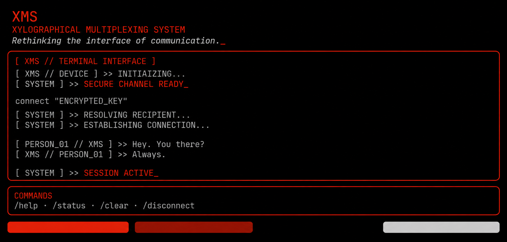

# XMS — Xylographical Multiplexing System

> Rethinking the interface of communication.

  

**XMS** is an Android communication system built around controlled connections and ephemeral, session-based communication.

It explores an alternative approach to digital communication, prioritizing privacy, minimal data retention and user control.

**Project Status:** Development temporarily paused  
**Planned Resumption:** December 20, 2026

---

## Overview

XMS is built around three principles:

- **Privacy:** Minimize persistent data and unnecessary information retention.
- **Control:** Give users explicit control over establishing and terminating connections.
- **Simplicity:** Provide a focused communication experience without conventional messaging patterns.

---

## V1 — Ephemeral Communication

V1 establishes the foundational communication architecture of XMS.

Its objective is to enable temporary, synchronous communication without maintaining persistent message histories.

- One-to-one communication through established Secure Links.
- Both participants must be online to communicate.
- Messages are held in application memory (RAM) during an active session.
- Real-time message delivery through Supabase Realtime.
- No persistent message storage or conversation history.
- No offline message queue or message recovery.
- Temporary message state is cleared when the session ends.
- TLS-protected communication and backend-enforced access controls.

**V1 Security Model:** TLS protects data in transit. V1 does not implement end-to-end encryption.

---

## V2 — End-to-End Encryption

V2 extends the V1 communication model with end-to-end encryption.

Planned capabilities include:

- Device identity and cryptographic key management.
- Secure key exchange.
- Identity verification.
- End-to-end message encryption and decryption.
- Integration of established cryptographic protocols.
- Expanded communication and message synchronization capabilities.

The cryptographic implementation will rely on established protocols and reviewed libraries rather than proprietary encryption algorithms.

**Status:** Planned

---

## Core Architecture

| Component | Purpose |
|---|---|
| Secure Links | Establish and manage user-to-user connections. |
| Session Management | Manage authentication and active communication sessions. |
| Real-time Communication | Deliver live communication events. |
| Memory-based Message Handling | Hold temporary message state during active sessions. |
| Access Control | Enforce user-specific backend permissions. |
| Data Retention | Minimize persistent communication data. |

---

## Interaction

XMS provides a custom command interface for connection management.

| Command | Purpose |
|---|---|
| `/link` | Initiate a connection request. |
| `/requests` | View incoming and outgoing requests. |
| `/grant` | Accept a connection request. |
| `/deny` | Reject a connection request. |
| `/cancel` | Cancel an outgoing request. |
| `/links` | View established Secure Links. |
| `/unlink` | Terminate a connection. |

---

## Security

Security is a core architectural consideration throughout XMS development.

| Layer | V1 | V2 |
|---|---|---|
| Transport Security | TLS | TLS |
| Authentication | Email OTP | Email OTP |
| Backend Access Control | Yes | Yes |
| Ephemeral Message Handling | Yes | Evolved architecture |
| End-to-End Encryption | Not implemented | Planned |
| Device Key Management | Not implemented | Planned |
| Identity Verification | Not implemented | Planned |

XMS does not claim production-grade security or end-to-end encryption in its current implementation.

---

## Technology Stack

| Component | Technology |
|---|---|
| Platform | Android |
| Language | Kotlin |
| UI Framework | Jetpack Compose |
| Backend | Supabase |
| Database | PostgreSQL |
| Authentication | Supabase Auth |
| Real-time Infrastructure | Supabase Realtime |
| Development Environment | Android Studio |

---

## Development Roadmap

### Phase 1 — Initial Foundation

- Terminal interface.
- Custom command parser.
- Session management.
- Demonstration connection.

**Status:** Completed

### Phase 2 — Connection Infrastructure

- Passwordless email OTP authentication.
- User profiles and identity management.
- Secure Link request lifecycle.
- Backend access controls.
- Real-time connection events.

**Status:** In Progress

| Milestone | Scope | Status |
|---|---|---|
| M3.1 | Backend foundation and request lifecycle | Completed |
| M3.2 | Android connection integration and Realtime | In Progress |
| M3.3 | Push notification integration | Planned |
| M3.4 | Application validation | Planned |

### Phase 3 — V1 Communication

- Live one-to-one communication.
- RAM-based temporary message handling.
- Session lifecycle management.
- Message-state cleanup.
- Communication validation.

**Status:** Planned

### Phase 4 — V2 Cryptographic Foundation

- Device identity.
- Cryptographic key management.
- Secure key exchange.
- Identity verification.

**Status:** Planned

### Phase 5 — V2 Encrypted Communication

- End-to-end encryption.
- Secure message transmission.
- Message synchronization.
- Expanded communication capabilities.

**Status:** Planned

### Phase 6 — Security Hardening & Release

- Security testing and auditing.
- Backend hardening.
- Performance optimization.
- Release preparation.

**Status:** Planned

---

## Visual Identity

XMS uses a restrained interface built around AMOLED black, Laser Red accents and monospaced typography.

| Element | Colour | HEX |
|---|---|---|
| Primary Accent | Laser Red | `#DD2200` |
| System Output | Muted Grey | `#777777` |
| Background | AMOLED Black | `#000000` |
| Dividers | Structure Grey | `#232323` |

---

## Development Philosophy

XMS follows a milestone-based development process emphasizing:

- Architectural clarity.
- Separation of responsibilities.
- Incremental implementation.
- Independent backend validation.
- Deliberate security review.
- Verified implementation before milestone completion.

AI-assisted development tools are used alongside implementation review and testing.

---

## Project Status & Disclaimer

XMS is an experimental software development project.

The initial interface, authentication foundation and backend connection infrastructure have been developed. Android connection integration and real-time event handling remain in progress.

V1 ephemeral messaging and V2 end-to-end encrypted communication are development objectives, not completed capabilities.

Development is temporarily paused to prioritize academic examinations, with work planned to resume on **December 20, 2026**.

---

*XMS — Rethinking the interface of communication.*
