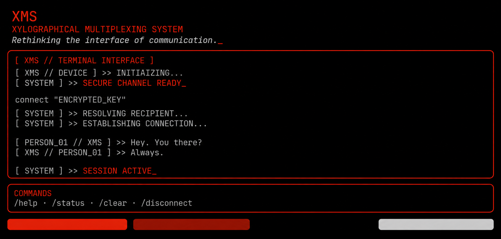

# XMS — Xylographical Multiplexing System

> Rethinking the interface of communication.

  

**XMS** is a terminal-first Android messaging application designed to explore a different approach to digital communication — replacing conventional chat interfaces with a minimal, command-driven terminal experience.

Built around a security-focused architecture, XMS aims to combine terminal-based interaction, privacy-oriented communication and end-to-end encryption.

**Project Status:** Under Active Development

---

## Vision

XMS aims to create a messaging environment where the terminal itself becomes the primary interface for communication.

Rather than following conventional messaging application designs, XMS explores a more minimal, technical and distinctive interaction model.

Its long-term vision is built around three principles:

- **Terminal-First Interaction:** Communication through a custom terminal interface.
- **Privacy & Security:** A security-focused architecture with end-to-end encryption as a core objective.
- **Minimalism:** A distraction-free interface built around simplicity and functionality.

---

## Core Objectives

- Terminal-based messaging and command interaction.
- User identity and connection management.
- Passwordless email authentication.
- Secure session management.
- Device identity and cryptographic key management.
- End-to-end encrypted communication.
- Privacy-oriented messaging architecture.

---

## Security & Encryption

Security is a fundamental architectural objective of XMS.

The long-term goal is to implement **End-to-End Encryption (E2EE)**, ensuring that message contents can only be accessed by the intended communicating devices.

The planned cryptographic foundation includes:

| Component | Objective |
|---|---|
| Device Identity | Establish cryptographic identities for individual devices. |
| Key Management | Securely generate, store and manage cryptographic keys. |
| Key Exchange | Establish secure shared secrets between communicating devices. |
| End-to-End Encryption | Encrypt messages before transmission and decrypt them only on authorized recipient devices. |
| Session Security | Protect authentication sessions and device access. |
| Identity Verification | Provide mechanisms to verify communicating identities and detect key changes. |

XMS intends to rely on established, reviewed cryptographic protocols and libraries rather than developing proprietary encryption algorithms.

**Current Security Status:** End-to-end encryption is a planned objective. The current prototype does not yet implement encrypted messaging, cryptographic key exchange or production-grade security guarantees.

---

## Technology Stack

| Component | Technology |
|---|---|
| Platform | Android |
| Programming Language | Kotlin |
| UI Framework | Jetpack Compose |
| Backend | Supabase |
| Database | PostgreSQL |
| Authentication | Supabase Auth |
| Development Environment | Android Studio |
| Version Control | Git & GitHub |

---

## Development Roadmap

### Phase 1 — Terminal Prototype
- Initial terminal interface.
- Custom command parser.
- Session management and ViewModel.
- Simulated demo connection.

**Status:** Completed

### Phase 2 — Backend & Identity Infrastructure
- Supabase client integration.
- Passwordless email OTP authentication.
- Persistent session management.
- Usernames and profiles.
- User discovery and connection requests.
- Push notification foundations.

**Status:** In Progress

### Phase 3 — Cryptographic Foundation
- Device identity generation.
- Cryptographic key management.
- Secure key exchange.
- Identity verification.
- Integration of established cryptographic protocols.

**Status:** Planned

### Phase 4 — Encrypted Messaging
- Actual message transmission.
- End-to-end encryption and decryption.
- Secure conversation handling.
- Message synchronization.

**Status:** Planned

### Phase 5 — Security Hardening & Release
- Security testing and auditing.
- Backend and database hardening.
- Performance optimization.
- Release preparation.

**Status:** Planned

---

## Visual Identity

XMS follows a terminal-inspired visual language built around AMOLED black, red accents and monospaced typography.

| Element | Colour | HEX |
|---|---|---|
| Primary / Outgoing | Laser Red | `#FF1744` |
| Incoming Messages | Soft Crimson | `#D50032` |
| Errors | Bright Scarlet | `#FF3131` |
| System Output | Muted Grey | `#777777` |
| Background | AMOLED Black | `#000000` |
| Dividers | Structure Grey | `#232323` |

The design philosophy emphasizes minimalism, readability and a distinctive terminal experience.

---

## Development Philosophy

XMS is being developed incrementally, with an emphasis on understanding the underlying architecture, maintaining clear separation of responsibilities and validating each milestone before moving forward.

AI-assisted development tools may be used throughout the development process, alongside implementation review, testing and architectural decisions.

---

## Project Status & Disclaimer

XMS is an experimental software development project and is currently under active development.

The existing implementation includes a terminal prototype and Supabase client integration. Authentication, real messaging, end-to-end encryption and production security are still under development or planned.

This repository will evolve as the project progresses.

---

*XMS — Rethinking the interface of communication.*
